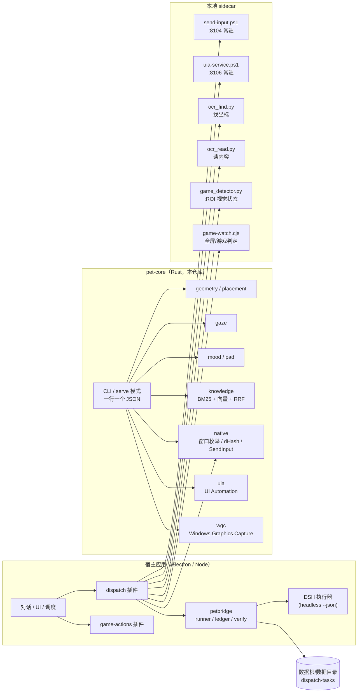

# 大肥鱼 · Control

**Windows 电脑操控层**：把「看屏幕、点按钮、按键、读字、切窗口」做成一套可复用的
Rust 内核 + 宿主插件 + 本地 sidecar 工具。从桌宠项目里拆出来，去掉所有业务逻辑，
只保留通用能力。

> 这不是一个能双击运行的桌面宠物。它是桌宠/助手类应用的**操控基础设施**：
> 宿主负责 UI 与对话，本仓库负责「真的把鼠标键盘和屏幕用起来」。

## 不含什么

- 不含 AI 模型、API Key、账号凭据。
- 不含执行器本体（派活默认接 DeepSeek Harness；需自行安装并用 `DSH_ROOT` 指到安装目录）。
- 不含宿主运行时 `petbridge/vts-server.mjs`（8103 服务在宿主侧；本仓库只带派活的
  账本 / 执行器适配 / 验收模块，以及与宿主无关的纯策略函数）。
- 不含游戏专用脚本（本项目只提供通用的窗口/输入/视觉原语，游戏 profile 由使用方自备）。
- 不含长期记忆召回模块（已移除，见 `NOTICE`）。
- 不含日志、截图、录屏、用户数据。
- 不含知识库数据（`pet-runtime/knowledge/` 需自备，见下文）。

## 快速开始

按顺序做完这三步即可验证内核；插件要再放进宿主才生效。

### 1. 前置

| 依赖 | 用途 | 说明 |
|---|---|---|
| Windows 10/11 x64 | 全部原生能力 | `native`/`uia`/`wgc` 仅在 Windows 目标编译 |
| Rust 1.75+ | 构建 `pet-core` | 依赖 `windows` 0.62、`windows-future` 0.3 |
| PowerShell 7（`pwsh`） | `pet-runtime/tools/*.ps1` sidecar | 不是 Windows PowerShell 5.1 |
| Python 3.11+ | OCR / 视觉工具（可选） | `pip install rapidocr-onnxruntime pillow numpy opencv-python`；`ocr_read.py` 另需本地 Ollama 或兼容 VLM |
| Node.js 18+ | `game-watch.cjs`、`petbridge/*.mjs` 与两个宿主插件 | 仅插件和派活层需要；`.mjs` 直接跑，无需构建 |
| 宿主应用 | 插件运行环境 | 需提供 `live-2d/js/core/plugin-base.js`；没有宿主时插件只能做语法检查 |
| DeepSeek Harness（可选） | 派活的默认后端执行器 | 不是本仓库依赖；只在用 `dispatch_to_dsh` 时需要，用 `DSH_ROOT` 指到安装目录 |

本仓库的 control 层**不需要 Cubism SDK / `.moc3` 模型**（那是同为桌宠项目的
`dafeiyu-perform` 渲染层的依赖）。

### 2. 放置路径

- 只想用 Rust 内核：在本仓库根执行构建即可，`pet-runtime/tools/` 保持原位。
- 想用宿主插件：本仓库的 `live-2d/` 就是宿主侧目录形状。
  1. 把 `live-2d/js/core/*.js` 拷到宿主的 `live-2d/js/core/`（**不要覆盖宿主已有的 `plugin-base.js`**）。
  2. 把 `live-2d/plugins/community/dispatch/`、`live-2d/plugins/community/game-actions/`
     整体拷到宿主的 `live-2d/plugins/community/` 下。
  3. 把 `pet-runtime/tools/` 放到宿主应用根（即宿主 `live-2d/` 的上一级）的 `pet-runtime/tools/`。
     插件按「`plugins/community/dispatch` 往上 4 层」定位这个目录；层级不同就必须改配置或同步调整。
  4. 要用派活 v2 时，把 `live-2d/petbridge/` 一并拷到宿主的 `live-2d/petbridge/`。
     宿主的 8103 服务（如自带 `vts-server.mjs`）通过 `dispatch-runner.mjs` /
     `dispatch-ledger.mjs` / `dispatch-verify.mjs` 接线；也可用你自己的 HTTP 服务实现同款接口。
- 知识库（可选）：把自备数据放到 `<宿主应用根>/pet-runtime/knowledge/`
  （`rules/`、`live/`、`experience/`、`templates/`）。目录不存在时 `knowledge` 工具会明确返回「未安装知识库」。

### 3. 验证

```bash
cargo test                     # 55 个纯逻辑单测
cargo build --release          # 产物 target/release/pet-core.exe
node --check live-2d/plugins/community/dispatch/index.js
node --check live-2d/plugins/community/dispatch/game-control.js
node --check live-2d/plugins/community/game-actions/index.js
node --check live-2d/petbridge/dispatch-runner.mjs
node tests/test-dispatch-v2-p1.cjs
node tests/test-dispatch-followup-policy.cjs
node tests/test-dispatch-retry-policy.cjs
node tests/test-capabilities.mjs
echo '{"cmd":"windows"}' | target/release/pet-core.exe   # 应输出一行窗口枚举 JSON
```

Python-side 工具按需再验（不会启动常驻服务）：

```bash
python -m py_compile pet-runtime/tools/*.py        # 语法/依赖导入前检查
pwsh -NoProfile -File pet-runtime/tools/foreground-rect.ps1   # 每 2s 输出一行矩形，Ctrl+C 结束
```

## 架构



### 派活执行层（可选）

`live-2d/petbridge/` 是「把长任务交给后台编码 agent」的纯 Node 层，不依赖 Electron：

```text
dispatch 插件 ──POST /dispatch──▶ 宿主 8103 服务（vts-server 或自实现）
                                      │
                                      ├─ dispatch-runner.mjs   起 DSH 并持句柄，解析 NDJSON 事件
                                      ├─ dispatch-verify.mjs   settle → 文件快照 diff → verify 四态
                                      └─ dispatch-ledger.mjs   <数据根>/<数据目录>/dispatch-tasks/
```

- **执行器位置**：优先 `DSH_ROOT`，其次 `DSH_HOME`；都没配时 `DEFAULT_DSH_ROOT` 为空字符串，
  真正 spawn 失败会在错误里给出「去哪配」的指引（`DSH_ROOT_HINT`），不会静默退化成假成功。
- **凭据**：只读取 `DSH_CREDENTIALS`（默认 `<DSH_ROOT>/.credentials.yaml`）里的
  `COMAD_BUNNY_API_KEY` / `DEEPSEEK_API_KEY` 注入子进程；**不打印、不落盘、不写日志**。
- **数据根**：账本与记录目录统一走 `PET_DATA_ROOT` + `PET_DATA_DIR_NAME`（缺省 `data`）。
  默认位置是 `<宿主应用根>/data/`；可用环境变量指到任意目录。
- **CLI 薄壳**：`node live-2d/petbridge/dsh-dispatch.mjs --task "..." [--session id] [--json]`
  只用于手动跑一次；与主进程共用同一份 `createDispatchRunner` 实现。
- **vts-server 不在本仓库**：8103 的 HTTP 路由属于宿主生命周期；本仓库提供被它调用的
  账本/执行器/验收模块。集成测试因此默认跳过，设 `MYNEURO_LIVE2D_DIR` 指向含
  `petbridge/vts-server.mjs` 的宿主 `live-2d/` 后可跑满。

## 能力表

| 能力 | 入口 | 说明 |
|---|---|---|
| 窗口几何 / 面板布局 | `src/geometry.rs`、`src/placement.rs` | 面板与字幕贴边、翻边、clamp 到工作区；纯函数 |
| 眼神跟随参数 | `src/gaze.rs` | 瞳孔/头部偏移与回中手感参数，带单测 |
| 心情衰减 | `src/mood.rs` | 正/负面半衰、tanh 软饱和；纯计算，时间由调用方传入 |
| PAD 情绪总线 | `src/pad.rs` | 情绪锚点插值 + 心情基线偏置 → 韵律 |
| 知识混合检索 | `src/knowledge.rs` | BM25 + 向量余弦 + RRF 融合 |
| 窗口枚举 / 焦点 / 空闲 | `src/native.rs` | `EnumWindows`、`GetLastInputInfo`、DPI |
| 屏幕 dHash | `src/native.rs` | GDI BitBlt，按块平均降采样，无图像库依赖 |
| 窗口采集（WGC） | `src/wgc.rs` | 按 HWND 采集，**能抓到被遮挡窗口**；可存 BMP / 原始 BGRA |
| UIA 元素树 / 动作 / 取文 | `src/uia.rs` | `FromHandle` + `FindAll(Descendants)` + `CacheRequest` |
| 键鼠注入 | `src/native.rs`、`pet-runtime/tools/send-input.ps1` | `SendInput`；常驻 HTTP 服务降低延迟；`key-policy.json` 拦截危险组合 |
| 屏幕找字（坐标） | `pet-runtime/tools/ocr_find.py` | RapidOCR；整屏 / 单窗 / 指定 ROI 三档 |
| 窗口读文（内容） | `pet-runtime/tools/ocr_read.py` | GLM-OCR 或 PaddleOCR-VL，输出结构化文本 |
| 游戏/全屏感知 | `pet-runtime/tools/game-watch.cjs` | 独占全屏、进程黑名单、标题关键词三选一 |
| 游戏画面 ROI 检测 | `pet-runtime/tools/game_detector.py` | 常驻进程，读 BGRA 帧 + ROI 规则 → 结构化状态 |
| 场景模板抓取 | `pet-runtime/tools/game-scene-capture.py` | WGC 抓帧 → 裁剪 → 存 PNG |
| 窗口枚举（C# 备选） | `pet-runtime/tools/WinEnum.cs` | 无 Rust 时的轻量替代 |
| 前台窗口矩形 | `pet-runtime/tools/foreground-rect.ps1` | 2s 轮询输出 `left,top,right,bottom` |
| 派活工具面 | `live-2d/plugins/community/dispatch/` | 15 个 LLM 工具：act/game/app/file/clipboard/batch/dispatch_to_dsh/dispatch_cancel/dispatch_followup/hand_action/knowledge/skill/appearance/see/check_dispatch |
| 派活账本 | `live-2d/petbridge/dispatch-ledger.mjs` | 每任务 JSON + JSONL 事件流；24h requestId 幂等；启动恢复把残留 running 改 unknown（永不自动重派） |
| 执行器适配 | `live-2d/petbridge/dispatch-runner.mjs` | 在宿主进程内 spawn 并持有 DSH 句柄；解析 NDJSON；`taskkill /T /F` 真取消 |
| 派活验收 | `live-2d/petbridge/dispatch-verify.mjs` | workspace 校验、settle→文件快照 diff、verify 四态（pass/fail/broken/timeout） |
| 续聊/重试策略 | `live-2d/js/core/dispatch-followup-policy.js`、`dispatch-retry-policy.js` | 纯函数；UI 与 IPC 共用同一道闸（终态+sessionId 才可续聊；只有 attempted=false 才可重试） |
| 功能注册表 | `live-2d/js/core/capabilities.js` | 一个功能一行：开关位置/默认值/是否热生效/实现文件；`auditCapabilities({ implRoot })` 与真实配置对账 |
| 游戏动作注册 | `live-2d/plugins/community/game-actions/` | 把游戏 profile 里的 actions 注册成 LLM 工具，换游戏只改数据 |

### pet-core CLI

一次性模式：`echo '{"cmd":"windows","filter":"chrome"}' | pet-core`

常驻模式：`pet-core serve`（stdin/stdout 一行一个 JSON，适合宿主长期复用）。

主要命令：`panel`、`subtitle`、`default`、`windows`、`focus`、`fg`、`world`、`idle`、
`screen_hash`、`gray_matrix`、`screen_shot`、`region_gray`、`wgc_hash`、`wgc_shot`、
`game_frame`、`uia_elements`、`uia_action`、`uia_text`、`edit_text`、`keys`、
`key_down`/`key_up`、`post_keys`、`post_text`、`mouse`、`mouse_down`/`mouse_up`、
`post_mouse`、`cursor_pos`、`window_from_point`、`window_op`、`release_all`、
`knowledge_search`、`mood`、`prosody`。

## 前置条件

- Windows 10/11 x64（`native`/`uia`/`wgc` 模块用 `cfg(target_os = "windows")` 门控）。
- Rust 1.75+（依赖 `windows` 0.62 与 `windows-future` 0.3）。
- PowerShell 7（`pwsh`）—— sidecar 脚本用。
- Python 3.11+ —— OCR / 视觉工具用；按需安装：
  `pip install rapidocr-onnxruntime pillow numpy opencv-python`
  （`ocr_read.py` 另需本地 Ollama 或兼容的 VLM 服务）。
- Node.js 18+ —— `game-watch.cjs` 与插件用。

## 构建

```bash
cargo build --release
# 产物：target/release/pet-core.exe
```

## 测试

```bash
cargo test                                  # 55 passed
node tests/test-dispatch-v2-p1.cjs          # 86 passed（2 节跳过：vts-server 不在仓内）
node tests/test-dispatch-followup-policy.cjs # 47 passed
node tests/test-dispatch-retry-policy.cjs    # 32 passed
node tests/test-capabilities.mjs             # 35 passed
```

55 个 Rust 单测覆盖布局、眼神、心情、PAD、BM25/向量/RRF、dHash、按键策略等纯逻辑。

Node 用例全部**自包含**，只写系统临时目录：

- `test-dispatch-v2-p1.cjs`：verify 四态、返工、workspace、真 `taskkill` 取消、
  账本恢复、插件工具面。第 3/4 节是 8103 集成用例，仓内没有 `vts-server.mjs` 时明确
  打印 SKIP 并以 0 退出；设 `MYNEURO_LIVE2D_DIR` 指向带 `vts-server.mjs` 的宿主
  `live-2d/` 后跑满 **162** 条断言。
- `test-dispatch-followup-policy.cjs`：续聊闸门（终态 + sessionId）、失配文案、
  请求体、插件入口真拒绝。
- `test-dispatch-retry-policy.cjs`：只有 `failed + attempted=false` 可重试；
  禁用原因、id 生成、请求体不夹带展示字段。
- `test-capabilities.mjs`：注册表结构、缺键/插件/死键自检、`implRoot` 可配置
  （默认根行为不变；指向完整宿主根时 impl-missing 归零）。
- `tests/e2e-click2.js` 仍是对真实桌面做 UIA 快照并点击，只能在交互式 Windows
  会话里手动跑，不纳入自动测试。

## 与宿主插件的接口

`live-2d/plugins/community/dispatch/` 与 `live-2d/plugins/community/game-actions/` 是**宿主插件**，
不是独立进程。宿主需提供：

1. **插件基类**：`require('<host>/js/core/plugin-base.js').Plugin`
   （本仓库不附带，因为它是宿主生命周期契约的一部分）
2. **生命周期**：`onInit()` → `onStart()` → `onStop()`
3. **上下文对象** `this.context`：
   - `getPluginFileConfig()` —— 返回 `plugin_config.json` 合并后的配置
   - `registerTool(def)` / `unregisterTool(name)` —— 注册/注销 LLM 工具
   - `log(...)`、`sendMessage(...)`
4. **插件依赖的 core 模块**：本仓库已自带在 `live-2d/js/core/`，放到位即可解析：
   `silent-audit.js`、`key-policy.js`、`geometry.js`、`json-store.js`、
   `runtime-paths.js`、`route-experience.js`、`skill-health.js`、
   `dispatch-followup-policy.js`、`dispatch-retry-policy.js`、`capabilities.js`，以及
   `route-experience.js` 的传递依赖 `records-path.js`。这些是**硬依赖**，
   缺任何一个都会让对应插件在 `require` 阶段失败，不是「缺失可降级」。
5. **派活的 8103 服务**：`dispatch` 插件的 `dispatch_to_dsh` / `dispatch_cancel` /
   `dispatch_followup` / `check_dispatch` 通过 HTTP 访问宿主的 8103 控制口。
   `live-2d/petbridge/` 提供账本、执行器适配与验收模块；HTTP 路由本身由宿主实现
   （本仓库不附带 `vts-server.mjs`）。没有 8103 时这些工具会返回「桌宠没在运行」。

以下宿主模块**不在本仓库**，按需提供：

| 模块 | 缺省行为 |
|---|---|
| `js/core/pet-core-client.js` | `game-control` 的 Rust 常驻客户端降级为每次起一次性进程；不影响其它功能 |
| `js/core/game-loop.js`（及其依赖 `fact-store.js`、`mod-provider.js`） | `game` 工具在调用时报 `MODULE_NOT_FOUND`；其它工具不受影响 |

### 知识库（可选，需自备）

`knowledge` 工具读取 `<宿主应用根>/pet-runtime/knowledge/` 下的四层数据：
`rules/`（稳定规则）、`live/`（会过期的动态攻略）、`experience/`（append-only 经验）、
`templates/`（截图模板）。**本仓库不附带任何知识库数据**。目录不存在时工具会返回
明确的「未安装知识库」及放置说明，不会伪装成「查了但没有条目」。

混合检索优先调用 `pet-core`（`knowledge_search`）。二进制查找顺序：
`PET_CORE_BIN` → `<root>/pet-core/target/{release,debug}/pet-core.exe` →
`<root>/target/{release,debug}/pet-core.exe`。找不到时退化为按层顺序返回，
不阻塞工具。

### 配置

| 环境变量 | 作用 | 默认 |
|---|---|---|
| `PET_DATA_ROOT` | 数据根目录 | 宿主应用根（含 `live-2d/` 与 `pet-runtime/` 的目录） |
| `PET_DATA_DIR_NAME` | 数据根下的子目录名（派活账本 + 记录目录） | `data` |
| `DSH_ROOT` | DeepSeek Harness 安装根目录（派活执行器） | 空；未配时 spawn 失败会给出配置指引 |
| `DSH_HOME` | 同上，`DSH_ROOT` 的别名（优先级更低） | 空 |
| `DSH_CREDENTIALS` | DSH 凭据 YAML 路径 | `<DSH_ROOT>/.credentials.yaml` |
| `MY_NEURO_CONFIG_PATH` | 宿主 `config.json` 路径 | `live-2d/config.json` |
| `PET_OCR_MODEL` | `ocr_read.py` 的 VLM 模型名 | `glm-ocr:latest` |
| `PET_CORE_BIN` | `pet-core` 可执行文件路径（供插件调知识检索） | 自动查找，找不到则退化为纯 BM25/按层返回 |
| `PET_EMBED_PORT` | 向量嵌入服务端口（OpenAI 兼容 `/v1/embeddings`） | `8090`，连不上则纯 BM25 |
| `PET_PYTHON` | `runtime-paths.js` 优先使用的 Python | 按环境变量 → 配置 → 官方安装目录 → `py` 启动器逐级解析 |

`pet-runtime/tools/key-policy.json` 是按键拦截的唯一策略源；`game_control` 与 `send-input.ps1`
都读它。修改后请同步 `src/native.rs` 内联表。

`live-2d/` 目录刻意保持宿主侧的层级，`dispatch` 插件的 `findProjectRoot` 依赖
「`plugins/community/dispatch` 往上 4 层 = 含 `pet-runtime/tools` 的根」这一约定。
若你的宿主目录层级不同，请把 `pet-runtime/tools/` 一并放到对应根下。

## 限制（请先读）

- **不做游戏专用逻辑**。仓库里没有「某游戏怎么打」的脚本；`game-actions` 只负责把
  使用方提供的 profile 注册成工具。
- **不越权**。所有输入注入都走 Windows 公开 API（`SendInput` / UIA / PostMessage），
  不使用驱动、不做注入、不绕过反作弊。`key-policy.json` 默认拦截
  `Alt+F4`、`Ctrl+Alt+Del`、`Ctrl+Esc`、`Win*` 等危险组合。
- **PostMessage 有边界**。DirectInput/Raw Input 游戏不认 `WM_KEYDOWN`；
  这类场景只能走 `SendInput`。
- **OCR 需要额外模型**。仓库不含任何 OCR/VLM 权重。
- **插件不是独立应用**。没有宿主时 `plugins/` 只能做语法检查，不能运行。
- **派活需要宿主 8103 + 执行器**。本仓库不附带 `vts-server.mjs`，也不附带
  DeepSeek Harness；只装本仓库时 `dispatch_to_dsh` 会明确报「桌宠没在运行」或
  「未配置 DSH_ROOT」，不会伪造成功。
- **UIA 覆盖率取决于目标程序**。自绘 UI（游戏、部分 Electron/Qt 应用）没有 UIA 树，
  只能用视觉方案。

## 许可

MIT（本仓库自有代码）。第三方归属见 `NOTICE`。
